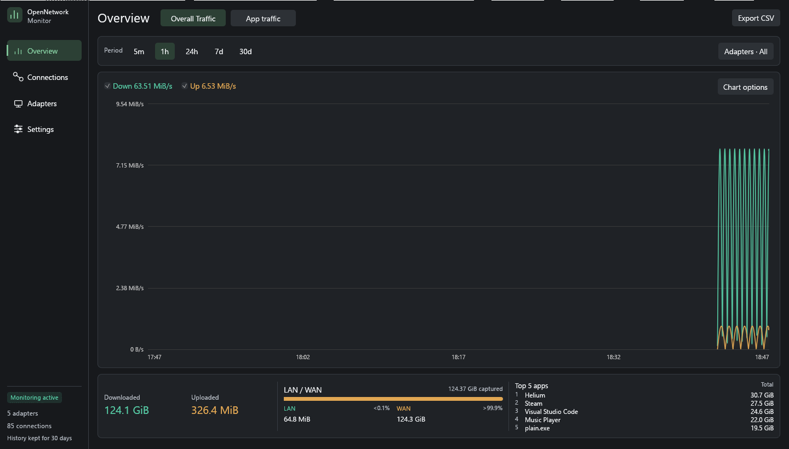
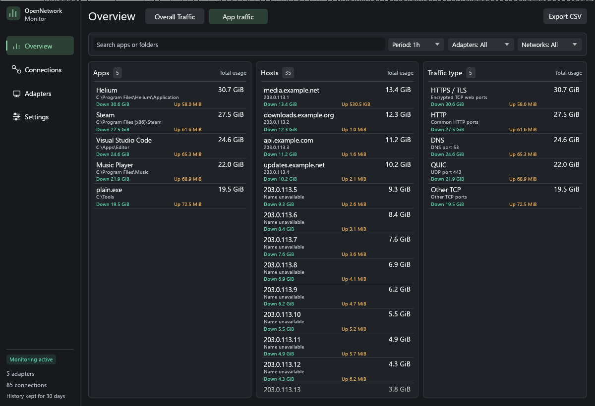

# OpenNetworkMonitor

A local-first Windows network monitor written in Rust with egui. No subscription, telemetry, account, Npcap installation, or Windows Data Usage service is required.

**Status:** working first implementation, not a finished GlassWire replacement. VPN-specific measurement still needs real-device validation.

## Run

Use Windows with Rust 1.95+ (MSVC toolchain) and Visual Studio C++ Build Tools. From the project folder:

```powershell
.\build.ps1
# Or from Command Prompt:
.\build.cmd
```

The script runs formatting, tests and strict Clippy, builds the release, and creates a versioned app folder, ZIP and SHA-256 checksum under `dist/`. It preserves an in-use build without terminating the running monitor. Exit the older copy from its tray before opening the new one. Compilation does not require administrator access.

For a faster rebuild after checks have already passed, use `.\build.ps1 -SkipChecks`. For a debug package, use `.\build.ps1 -Configuration Debug`. The script uses only project-local output folders and does not install toolchains or change system configuration. The Command Prompt wrapper's execution-policy setting applies only to its PowerShell process.

You can also use Cargo directly:

```powershell
cargo build --locked --release
.\target\release\OpenNetworkMonitor.exe
```

The executable now embeds an administrator requirement. Opening it requests Windows approval automatically, so detailed per-application monitoring starts with the required access. Build normally, then open the executable through Explorer; use an elevated terminal for `cargo run` or command-line diagnostics. The app does not install a driver, service, firewall rule, scheduled task, or startup entry.

Closing the window hides it to the system tray by default. Left-click the tray icon to reopen it; right-click → **Exit** stops the app directly. If creating the tray fails, closing the window exits instead. The process must remain running to record traffic.

## Screenshots

These previews use generated sample data.




## Implemented

- Native live adapter counters for the same present, non-hidden interfaces shown by Windows, including real disconnected Ethernet, Wi-Fi and VPN adapters. Hidden/filter/loopback entries stay out of the visible inventory. A persistent catalog retains usage when an adapter is unplugged.
- Native ETW kernel capture of TCP and UDP transfer events, IPv4 and IPv6, attributed using each event's payload PID.
- Upload/download, LAN/WAN/Unknown classification, adapter association from the local address, and an explicit Unassigned category.
- Two Overview buttons: **Overall Traffic** and **App traffic**. The compact adapter view fits its chart, compact upload/download summary and horizontal LAN/WAN breakdown without scrolling at the supported minimum window size. Its chart always uses exactly the selected usage period; unrecorded intervals remain blank. Overall Traffic keeps quick period buttons; App traffic puts search, period, multi-adapter and network dropdowns on one line. Advanced chart controls are tucked away.
- The Overall Traffic footer includes the **top five apps** by combined upload/download, using the selected period and adapters. Totals and the LAN/WAN bar share a compact band without repeating the period. The default window is wider; existing windows widen once for this layout and then retain later resizing.
- Dense 56-point rows in App traffic, with smaller directories/host/type descriptions and Down/Up figures. Overview omits the descriptive subtitle and the list omits the standing selection hint. Selected apps can be cleared from the Apps heading.
- Three compact, independently scrolling columns: **Apps**, **Hosts** and **Traffic type**, each ranked by combined upload and download in the selected usage period. App names show the executable directory directly below; absent friendly metadata, the exact executable filename is kept. Selecting an app filters the adjacent lists; selecting it again or choosing All apps clears that selection. Live rates remain in app tooltips.
- Background host-name resolution through the Windows system resolver, with IP fallback. Common traffic types (HTTP, HTTPS/TLS, DNS, QUIC and others) are inferred from connection ports and saved with history. No payload inspection or decryption is performed.
- Live TCP connection and UDP socket inventory, process names, local/remote endpoints, protocol and state.
- Optional offline country lookup from a user-supplied GeoLite2/GeoIP2 Country or City `.mmdb` file. No database is bundled and country lookup sends no online requests.
- A compact 90% default interface size, adjustable from 80% to 110% in Settings → Appearance. The saved size applies throughout the app.
- A neutral **Slate** default with brighter text and Segoe UI typography, plus Light, Nord and Catppuccin Mocha palettes.
- Four sidebar destinations: Overview, Connections, Adapters and Settings. App traffic lives in Overview. Shared panel spacing, aligned headers, readable usage totals, labeled Down/Up values and a persistent monitoring status keep navigation consistent.
- A fitted Connections table with PID/folder subtitles, bounded address columns and full-value tooltips. Adapter actions align across rows and open the selected adapter directly in Overview. Settings are grouped into sections, with detailed measurement notes collapsed by default.
- SQLite minute-level history with thirty-day retention, stored in `%LOCALAPPDATA%\OpenNetworkMonitor\usage.db`.
- CSV export of the current usage filters (including the app search or selected app), with UTC timestamps, raw byte counts and traffic types. Existing export files are not overwritten.
- Persisted theme, filters, units, country-database path, window state and close-to-tray preference.
- Single-instance lock, visible capture errors and loss counters, bounded event queue and country cache, storage retries, background worker independent from rendering.

## Understand the measurements

**Overall Traffic** uses `GetIfTable2` interface-counter deltas, sampled approximately once per second. This does **not** use the historical Windows Settings → Data Usage/NDU store. It counts interface bytes across all protocols. Counters are baselined on startup; traffic before the app started is not imported. Resets and adapter reconnects do not create negative totals or wraparound spikes.

**App traffic** uses built-in ETW kernel TCP/IP and UDP/IP send/receive events through FerrisETW. It does not require Npcap. App totals reflect observed TCP/UDP transport events, not every link-layer byte or protocol. ACK/connect/retransmit event types are not added as separate usage. If capture cannot start, the UI explains why; adapter traffic is still collected.

The LAN/WAN bar summarizes captured TCP/UDP app traffic over the same selected adapter/history scope; its total is kept separate from interface-counter totals because the two measurements represent different layers. In App traffic mode, All adapters includes observed transport traffic including loopback; explicit adapter choices restrict it to those interfaces.

The two sources are **never added together**. Selecting every physical and virtual adapter is a sum of adapter observations, which may count the same traffic at several layers. VPN traffic may appear as inner application traffic and outer encrypted traffic belonging to a VPN process. This version does not claim a deduplicated all-PC internet total across arbitrary VPNs. Select a physical adapter for its observed wire traffic, or select particular application/transport views for their observed traffic. Validating the exact VPN stack is part of the next milestone.

LAN includes private, loopback, link-local, multicast, broadcast and on-link destinations. WAN means public destinations; reserved/shared ranges are Unknown. This is an address-based classification, not proof of a routing boundary. Public destinations routed through a private gateway remain WAN. Adapter association is inferred from a unique local-address match; ambiguous matches remain Unassigned.

Socket tables expose TCP remote endpoints but not UDP destinations. Observed UDP destinations appear in the application history when ETW is active. Socket inventory is refreshed every five seconds independently of the usage filters. Friendly names come from Windows FileDescription/ProductName resources, so browsers such as Helium retain their brand even when the binary is named chrome.exe. Process identities are refreshed every five seconds; very short-lived processes can remain unnamed and PID reuse inside that interval is a known limitation.

Host names use reverse DNS through your configured Windows resolver, on two background threads with bounded queues and caching. Requests occur for the displayed host list. Shared hosting/CDN names can differ from the website visited; IPs remain in subtitles or tooltips. Host-name resolution can generate ordinary DNS traffic. It does not contact a separate IP lookup service. Traffic-type labels are port-based estimates, so encrypted DNS carried on HTTPS ports appears as HTTPS/TLS. Existing history without recorded ports remains **Unclassified**, retaining its original byte counts.

History is stored in UTC minute buckets. The chart follows the selected 5m/1h/24h/7d/30d period and refreshes every second. Recent adapter samples are stored for 24 hours and survive reopening; older history uses minute aggregates. Long ranges are downsampled for display. Missing samples produce gaps rather than invented zero traffic or lines across downtime. Period selection rounds down to a minute. Empty time spans stay empty on the graph. Measured zero traffic is still shown as zero. Freeze pauses the chart only; recording, range totals and live speed continue. Country lookup applies to newly captured traffic and is approximate.

## Diagnostics and verification

```powershell
cargo fmt --check
cargo test
cargo clippy --all-targets -- -D warnings
cargo run -- --diagnose 8
# In an elevated terminal:
cargo run -- --self-test-capture
```

`--diagnose` prints adapter inventory, connection/process counts, per-protocol observed events, byte deltas and loss counters. `--self-test-capture` generates known local TCP and UDP payloads over IPv4 and IPv6, verifies payload delivery, and checks attribution to the test process for all four protocol families. Diagnostics do not write usage history. They do not change network configuration or install anything.

See [docs/ADMIN.md](docs/ADMIN.md) for administrator-launch details, and [docs/ARCHITECTURE.md](docs/ARCHITECTURE.md), [docs/ROADMAP.md](docs/ROADMAP.md), and [docs/VALIDATION.md](docs/VALIDATION.md). Build/test status is recorded in the validation document, including checks that could not be completed.

## Sources

- [Microsoft: GetIfTable2](https://learn.microsoft.com/en-us/windows/win32/api/netioapi/nf-netioapi-getiftable2)
- [Microsoft: TCP/IP ETW events](https://learn.microsoft.com/en-us/windows/win32/etw/tcpip)
- [Microsoft: UDP IPv4 transfer events](https://learn.microsoft.com/en-us/windows/win32/etw/udpip-typegroup1)
- [Microsoft: GetExtendedTcpTable](https://learn.microsoft.com/en-us/windows/win32/api/iphlpapi/nf-iphlpapi-getextendedtcptable)
- [FerrisETW](https://github.com/n4r1b/ferrisetw)
- [egui](https://github.com/emilk/egui)

MIT license. Theme and dependency credits are in [THIRD_PARTY.md](THIRD_PARTY.md).

## Storage reliability

Live adapter samples and usage totals commit together, using SQLite FULL synchronization. A normal exit stops the event producer, drains its final buffers, commits the last partial sample and checkpoints the database before the worker finishes. Saved chart data loads before the first new live tick after reopening. SQLite integrity is checked on open; corrupted history is reported rather than silently replaced with an empty database. The bundled SQLite version is 3.54.1.

## UI development

The optional preview uses generated sample data, without user settings, capture, tray integration or database access:

```powershell
cargo run --example ui_preview --features ui-preview -- apps --small
# Other initial screens: overview, connections, adapters, settings; add --light for Light.
```

For an offline review of the actual egui geometry (no desktop input):

```powershell
cargo test --features ui-preview export_ui_review -- --ignored
python scripts/render_ui.py
```

The renderer needs NumPy and Pillow and writes local PNGs under the ignored target/ui-review folder. Sample-data previews are separate from live monitoring. Default builds do not include the preview feature.
