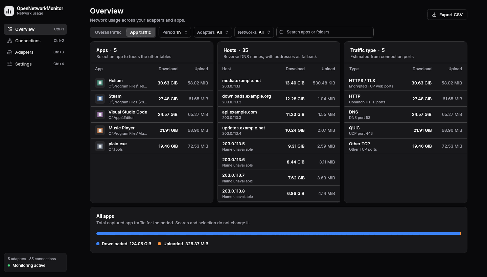
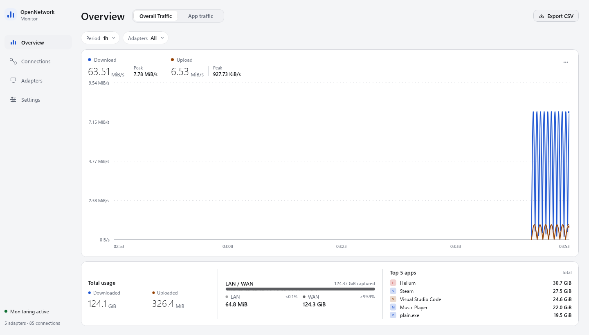

  

<h1 align="center">OpenNetworkMonitor</h1>

  A local-first network monitor for Windows. 
  See which apps use your connection, how much, and where it goes. 
  No account, no telemetry, nothing leaves your PC.

<table>
  <tr>
    <td></td>
    <td></td>
  </tr>
</table>

Screenshots use generated sample data.

## What it does

- **Live speed and history.** Download and upload charts with period and adapter filters, totals, and your busiest apps.
- **Per-app traffic.** Ranked apps, hosts and traffic types, plus daily and monthly history for any app.
- **Connections.** A live table of TCP and UDP connections with process names. Right-click to copy, filter or end a process.
- **Adapters.** Every network adapter, including Wi-Fi networks by name, with usage kept even after it's unplugged.
- **Alerts.** A notification when a new app uses the network, and a monthly data cap with warnings.
- **Runs in the tray.** Pause recording, launch at sign-in, and pick the tray icon colour.
- **Compact history.** Old minute-by-minute history is merged a calendar month at a time into hourly and, optionally, daily totals, with lifetime totals kept for every host, so the database stays small.
- **Safe to crash.** A small log and a crash handler record what went wrong and save the traffic still in memory.
- **Light, dark and accent colours.** CSV export, and a local SQLite history you own.

## Get started

1. Download `OpenNetworkMonitor.exe` from the [latest release](https://github.com/joeabouserhal/OpenNetworkMonitor/releases/latest).
2. Run it and approve the administrator prompt. Per-app monitoring needs it.

Closing the window keeps it running in the tray. Right-click the tray icon and choose **Exit** to stop it.

No driver, service or firewall rule is installed. To build it yourself, see [docs/DEVELOPMENT.md](docs/DEVELOPMENT.md).

## Good to know

- **Two kinds of numbers.** Overall traffic comes from adapter counters. App traffic comes from per-app TCP and UDP events. They measure different things and are never added together.
- **VPNs and merged connections.** A VPN or bonding tunnel carries the same traffic as the adapters under it. Selecting every adapter can count it twice, so pick the physical adapters for a clean total.
- **Early days.** This is a working first version, not a finished GlassWire replacement. [How the numbers work](docs/HOW_IT_WORKS.md) explains the details and limits.

## Shortcuts

`Ctrl+1` to `Ctrl+4` switch page, `Ctrl+F` searches, `Ctrl+E` exports CSV, `Esc` clears the selected app.

## Documentation

| Document | What's inside |
| --- | --- |
| [HOW_IT_WORKS.md](docs/HOW_IT_WORKS.md) | How traffic is measured, and the limits |
| [DEVELOPMENT.md](docs/DEVELOPMENT.md) | Building, diagnostics and UI preview |
| [PRIVACY.md](docs/PRIVACY.md) | What is stored and what is changed |
| [ADMIN.md](docs/ADMIN.md) | Why it needs administrator rights |
| [UNINSTALL.md](docs/UNINSTALL.md) | Installing and removing the app |
| [ARCHITECTURE.md](docs/ARCHITECTURE.md) | How the code is organised |
| [ROADMAP.md](docs/ROADMAP.md) | What's planned next |
| [VALIDATION.md](docs/VALIDATION.md) | Build and test status |

## License

Released under the **MIT License**. See [LICENSE](LICENSE) and [THIRD_PARTY.md](THIRD_PARTY.md).
