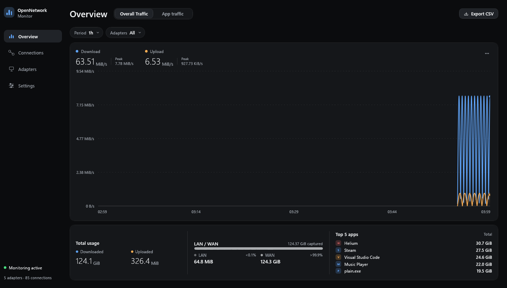

# OpenNetworkMonitor

A local-first network monitor for Windows, written in Rust with [egui](https://github.com/emilk/egui).

No subscription, telemetry, account, Npcap install, or Windows Data Usage service required. Everything stays on your PC.

> **Status:** a working first implementation, not yet a finished GlassWire replacement. VPN measurements still need validation on real devices.



<sub>Screenshots use generated sample data.</sub>

---

## Contents

- [Features](#features)
- [Quick start](#quick-start)
- [How the numbers work](#how-the-numbers-work)
- [Diagnostics and verification](#diagnostics-and-verification)
- [Storage reliability](#storage-reliability)
- [UI development](#ui-development)
- [Documentation](#documentation)
- [Sources and license](#sources-and-license)

---

## Features

### Traffic views

- **Overview** has two modes, **Overall Traffic** and **App traffic**. Both share matching period and adapter dropdowns.
  - The chart uses smooth curves within the selected period. Recorded samples stay exact, and unrecorded gaps stay blank.
  - Overall Traffic shows a **top five apps** footer and a LAN/WAN breakdown.
  - App traffic adds a network dropdown and search, plus a download/upload summary with a proportional bar.
- **Three ranked lists** in App traffic: **Apps**, **Hosts**, and **Traffic type**. Each is sorted by combined upload and download. Selecting an app filters the other two lists. Select it again, or choose All apps, to clear.
- **Per-app history.** Selecting an app adds a bar chart of its usage:
  - **Over time** follows the selected period.
  - **Daily** always shows the last 30 calendar days.
  - **Monthly** always shows the last 12 months.
- **Wi-Fi filtering.** The Adapters menu lets you filter recorded traffic by Wi-Fi network name. It works with the period, adapter, and network filters, and carries into CSV exports.
- **Hosts and traffic types.** Host names come from reverse DNS through your Windows resolver, with IP fallback. Traffic types (HTTP, HTTPS/TLS, DNS, QUIC, and others) are estimated from ports. No payloads are inspected or decrypted.
- **Country lookup (optional).** Point the app at your own GeoLite2/GeoIP2 Country or City `.mmdb` file. No database is bundled, and lookups never go online.

### Connections

- A live table of TCP connections and UDP sockets, with process names, endpoints, protocol, and state.
- Sortable columns, Protocol and Status filters, and resolved host names for public addresses.
- Right-click to copy addresses or details, show only one app, open the file location, or end the process (after confirmation).

### Adapters

- Shows the same present, visible adapters that Windows does, including disconnected Ethernet, Wi-Fi, and VPN adapters.
- Usage is kept per adapter, even after it's unplugged.
- Opening an adapter from here jumps straight to it in Overview.

### Alerts and limits

- **New app alert:** a notification the first time an app uses the network.
- **Monthly data cap:** set a reset day. The app warns at 80% and again when the cap is used up.
- Alerts show as Windows notifications and as an in-app banner. The cap meter appears in Settings and the sidebar.

### Look and feel

- A modern, minimal design with tonal cards, pill filters, and popovers.
- Themes: **Slate** (default dark), **Light**, **Nord**, and **Catppuccin Mocha**. **Match Windows appearance** switches between Slate and Light with your system setting.
- Colour is reserved for data: download is blue, upload is orange. On Windows 11 the title bar matches the theme.
- Interface size is adjustable from 80% to 110% in **Settings → Appearance** (default 90%).
- Sidebar with Overview, Connections, Adapters, and Settings. In narrow windows it becomes an icon rail.
- Screen-reader labels on painted figures, the chart, and Connections rows.

### Background and tray

- **Tray menu:** Open, Open Settings, **Pause recording** (the live display continues, nothing is saved), and Exit. The tooltip shows live speeds.
- **Launch when I sign in:** in **Settings → Background monitoring**. It starts in the tray using your elevated session and a per-user scheduled task. The option only appears when the app is in a folder ordinary programs can't change, such as Program Files, and it can be turned off in the same place.

### Keyboard shortcuts

| Shortcut | Action |
| --- | --- |
| `Ctrl+1` to `Ctrl+4` | Switch page |
| `Ctrl+F` | Focus search |
| `Ctrl+E` | Export CSV |
| `Esc` | Clear the selected app |

### Export and history

- **CSV export** of the current filters, including any app search or selected app. Timestamps are UTC, byte counts are raw, and existing files are never overwritten.
- **History** is saved in SQLite at `%LOCALAPPDATA%\OpenNetworkMonitor\usage.db`, in minute-level buckets, with no automatic expiry.
- **Saved settings:** theme, filters, units, alert choices, country database path, window state, and close-to-tray preference.

### Reliability

- Single-instance lock.
- Capture errors and loss counters are shown in the UI.
- Bounded event queue and country cache.
- Storage retries, and a background worker that runs separately from rendering.

---

## Quick start

You need Windows, Rust 1.95+ (MSVC toolchain), and Visual Studio C++ Build Tools.

From the project folder, run one of:

```powershell
.\build.ps1
# or, from Command Prompt:
.\build.cmd
```

The script checks formatting, runs tests and strict Clippy, builds a release, and puts the single `OpenNetworkMonitor.exe` in `dist/`.

**Handy options**

| Command | What it does |
| --- | --- |
| `.\build.ps1 -SkipChecks` | Rebuild quickly once checks have already passed |
| `.\build.ps1 -Configuration Debug` | Build a debug executable (`dist/OpenNetworkMonitor-debug.exe`) |

The script only writes to project-local folders. It doesn't install toolchains or change system settings. Compiling doesn't need administrator access.

<details>
<summary>Using Cargo directly</summary>

```powershell
cargo build --locked --release
.\target\release\OpenNetworkMonitor.exe
```

</details>

### Running it

- **Launch it from Explorer.** The executable asks for administrator approval automatically, because per-application monitoring needs that access. Use an elevated terminal only for `cargo run` or command-line diagnostics.
- **Only one copy runs at a time.** If you open a newer build while an older one is running, the older copy is asked to save and exit, and the new one takes over. If the older copy predates this hand-over, exit it from the tray first.
- **Closing the window hides it to the tray.** Left-click the tray icon to reopen. Right-click → **Exit** saves final data and stops the app. If the tray can't be created, closing the window exits instead.
- **The process must keep running to record traffic.**
- **No driver, service, or firewall rule is installed.** Optional launch at sign-in lives in **Settings → Background monitoring** (see [Features](#features)). For the installer script, see [docs/UNINSTALL.md](docs/UNINSTALL.md).

---

## How the numbers work

Different sources measure different things, so read this section before comparing figures.

### Overall Traffic (interface counters)

- Uses `GetIfTable2` interface-counter deltas, sampled about once per second.
- Does **not** use the Windows Settings → Data Usage store.
- Counts all protocols on each interface.
- Counters are baselined at startup, so traffic from before launch isn't imported. Resets and reconnects never create negative totals or spikes.

### Wi-Fi connections

- Grouped by network name (SSID), including the same name seen on several adapters.
- The Adapters menu lists networks seen while the app is running, plus an **Unidentified Wi-Fi** option for traffic that can't be assigned with confidence.
- Some traffic can stay unidentified: network switches between samples, Windows lookup failures, and very brief switches may not be detected.
- Traffic recorded before this feature existed counts in all-connection totals but can't be assigned to a specific network.
- Names are stored locally and kept in the catalog even after the matching history expires.

### App traffic (ETW)

- Uses built-in ETW kernel TCP/IP and UDP/IP send and receive events, through [FerrisETW](https://github.com/n4r1b/ferrisetw). Npcap isn't needed.
- Totals reflect observed TCP and UDP transport events. They aren't every link-layer byte. ACK, connect, and retransmit events aren't counted as separate usage.
- If capture can't start, the UI says why. Adapter traffic is still collected.
- Each event is attributed using its payload PID.
- Traffic is matched to a Wi-Fi network only when its local address matches a Wi-Fi adapter. VPN and other unmatched traffic may be left out of a named-network view.
- **Friendly names** come from Windows FileDescription and ProductName resources. Browsers keep their brand even when the binary is named `chrome.exe`.
- Process identities refresh every five seconds. A process that sends traffic between refreshes is named immediately while it's still running. A process that exits before lookup shows as `Process N`. PID reuse within one refresh interval is a known limitation.

### LAN and WAN

- **LAN** covers private, loopback, link-local, multicast, broadcast, and on-link destinations. **WAN** covers public destinations. Reserved and shared ranges are **Unknown**.
- This is address-based, not proof of a routing boundary. Public destinations routed through a private gateway still count as WAN.
- Adapter association comes from a unique local-address match. Ambiguous matches stay **Unassigned**.
- The LAN/WAN bar uses captured TCP/UDP app traffic, so its total is kept apart from interface-counter totals. In App traffic mode, **All adapters** includes loopback.

### Combining sources and VPNs

- The two sources are **never added together**.
- Selecting every adapter sums observations that can count the same traffic at several layers.
- VPN traffic can show up twice: as inner application traffic, and as outer encrypted traffic from the VPN process.
- There's no deduplicated all-PC internet total across arbitrary VPNs in this version.
- For clean numbers, select one physical adapter (its wire traffic), or a particular app or transport view. Validating the exact VPN stack is the next milestone.

### Sockets and hosts

- TCP tables show remote endpoints. UDP tables don't, so observed UDP destinations appear in app history while ETW is active.
- Socket inventory refreshes every five seconds, independent of your usage filters.
- Host names use reverse DNS on two background threads with bounded queues and caching. Lookups only cover hosts on screen. Shared hosting and CDNs can show a different name from the site you visited. IP addresses stay in subtitles and tooltips.
- Host lookups create ordinary DNS traffic. No separate IP lookup service is contacted.
- Traffic-type labels are port-based guesses, so encrypted DNS on HTTPS ports shows as HTTPS/TLS.
- Older history without recorded ports stays **Unclassified**, keeping its original byte counts.

### Known limits

- **TCP downloads recorded before the receive-endpoint fix** may have a wrong destination, adapter, network, or traffic type. The original remote endpoint wasn't saved, so those details can't be rebuilt. New traffic uses the corrected mapping.
- **Deleted history** from older versions can't be recovered.

### Time ranges and charts

- The chart follows the selected period: 15m, 30m, longer presets, *Since beginning of month*, *All time*, or a custom rolling duration or date range.
- Month-to-date starts at local midnight on the first day and updates when the month changes.
- Custom ranges use local time and include the full final minute. CSV timestamps stay UTC.
- Views up to 24 hours refresh every second. Longer and all-time views refresh every five seconds.
- Recent adapter samples are kept for 24 hours and survive restarts. Older data uses minute aggregates. Long ranges are downsampled for display.
- Missing samples show as gaps, never as invented zeros or lines across downtime. Measured zero traffic still shows as zero.
- **Freeze** pauses only the chart. Recording, range totals, and live speed keep going.
- Country lookups apply to newly captured traffic and are approximate.

---

## Diagnostics and verification

```powershell
cargo fmt --check
cargo test
cargo clippy --locked --all-targets --features ui-preview -- -D warnings
cargo run -- --diagnose 8
# In an elevated terminal:
cargo run -- --self-test-capture
# Optional: a small HTTP request to 1.1.1.1:80
cargo run -- --self-test-public
```

| Command | What it checks |
| --- | --- |
| `--diagnose` | Adapter inventory, connection and process counts, per-protocol events, byte deltas, and loss counters |
| `--self-test-capture` | Known local TCP and UDP payloads over IPv4 and IPv6, checking delivery and endpoint attribution |
| `--self-test-public` | A small fixed HTTP request to 1.1.1.1:80, checking TCP endpoints, adapter, WAN classification, and byte counts |

The diagnostic commands don't write usage history, though a running monitor can record their traffic. None of them change network settings or install anything.

Build and test status, including anything that couldn't be completed, is recorded in [docs/VALIDATION.md](docs/VALIDATION.md).

---

## Storage reliability

- Adapter samples and usage totals are committed together, using SQLite `FULL` synchronization.
- On a normal exit, the app stops capture, drains its buffers, saves the final partial sample, and runs a non-blocking checkpoint.
- If another program has the database open, committed data stays in the WAL until it can be checkpointed.
- Saved chart data loads before the first new live tick after reopening.
- Integrity is checked in the background at launch, and before any file-layout upgrade.
- A history that can't be opened is **never silently replaced**. The app offers to move the damaged files aside, keeping them, and start a fresh history.
- Chart and list reads use a separate read-only connection, so they never slow capture.
- Bundled SQLite version: 3.54.1.

---

## UI development

The preview uses generated sample data. It has no settings, capture, tray, or database access.

```powershell
cargo run --example ui_preview --features ui-preview -- apps --small
# Other screens: overview, connections, adapters, settings. Add --light for Light.
```

For an offline review of the real egui layout, with no desktop input:

```powershell
cargo test --features ui-preview export_ui_review -- --ignored
python scripts/render_ui.py
```

The renderer needs NumPy and Pillow, and writes PNGs to the git-ignored `target/ui-review` folder. Default builds don't include the preview feature.

---

## Documentation

| Document | What's inside |
| --- | --- |
| [ADMIN.md](docs/ADMIN.md) | Administrator launch details |
| [PRIVACY.md](docs/PRIVACY.md) | What is stored and what is changed |
| [UNINSTALL.md](docs/UNINSTALL.md) | Installing and removing the app |
| [ARCHITECTURE.md](docs/ARCHITECTURE.md) | How the code is organised |
| [ROADMAP.md](docs/ROADMAP.md) | What's planned next |
| [VALIDATION.md](docs/VALIDATION.md) | Build and test status |
| [THIRD_PARTY.md](THIRD_PARTY.md) | Dependency and theme credits |

---

## Sources and license

Background reading for the measurements:

- [Microsoft: GetIfTable2](https://learn.microsoft.com/en-us/windows/win32/api/netioapi/nf-netioapi-getiftable2)
- [Microsoft: connected Wi-Fi network name](https://learn.microsoft.com/en-us/uwp/api/windows.networking.connectivity.wlanconnectionprofiledetails.getconnectedssid)
- [Microsoft: TCP/IP ETW events](https://learn.microsoft.com/en-us/windows/win32/etw/tcpip)
- [Microsoft: UDP IPv4 transfer events](https://learn.microsoft.com/en-us/windows/win32/etw/udpip-typegroup1)
- [Microsoft: GetExtendedTcpTable](https://learn.microsoft.com/en-us/windows/win32/api/iphlpapi/nf-iphlpapi-getextendedtcptable)
- [FerrisETW](https://github.com/n4r1b/ferrisetw)
- [egui](https://github.com/emilk/egui)

Released under the **MIT License**. See [LICENSE](LICENSE) and [THIRD_PARTY.md](THIRD_PARTY.md).
